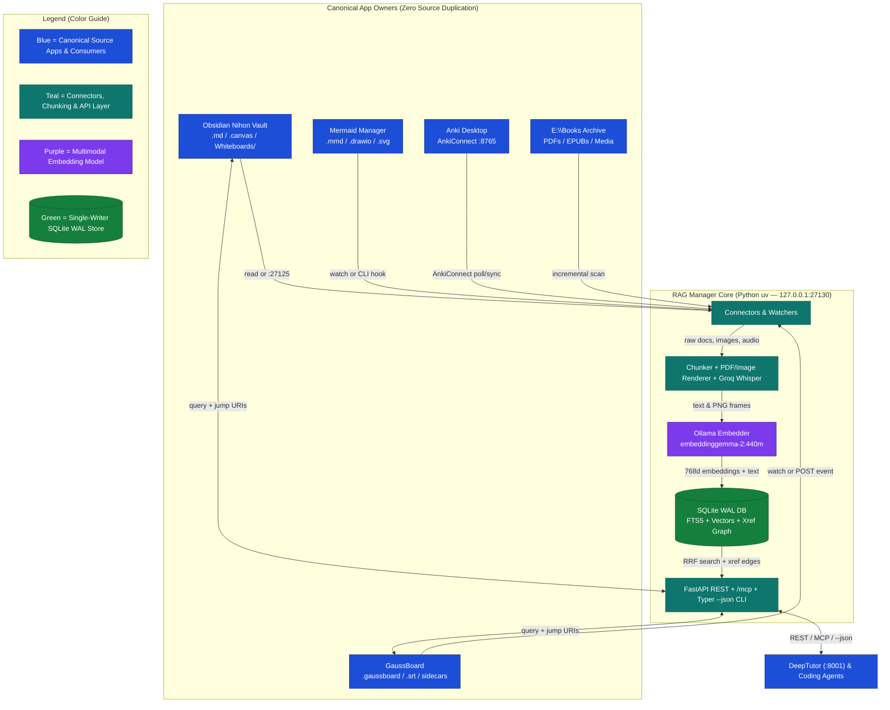
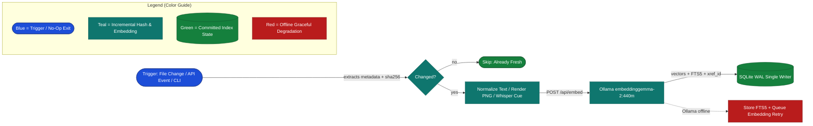

# System Architecture & Visual Flows (`ARCHITECTURE.md`)
> **1-Line Summary:** Single living visual map of `RAG Manager` (`rag-manager`), explaining its Python `uv` multimodal stack, Pentagram connector boundaries, SQLite WAL FTS5+vector schema, and extension recipes.

## 1. High-Level Visual System Map
* **Plain-English Overview:** Five independent study apps keep ownership of their own files while sending change events or letting `RAG Manager` watch their folders. `RAG Manager` chunks text, renders PDF/diagram images, transcribes lecture audio via Groq Whisper v3, embeds content with Ollama `embeddinggemma-2:440m`, and serves unified hybrid search + `xref_id` cross-links over `127.0.0.1:27130` (REST + `/mcp`) and `--json` CLI.

## 2. Tech Stack & Why We Chose It

| Layer | Tool / Library | Plain-English Reason Why |
| :--- | :--- | :--- |
| Runtime & Packaging | Python 3.12+ (`uv`) | Single AI-maintainable language for multimodal PDF/image handling, Groq Whisper SDK, MCP SDK, and `cli-hub` parity (no Go↔Python IPC split). |
| HTTP & MCP Server | FastAPI + Uvicorn + `mcp` | Serves REST + Streamable HTTP `/mcp` cleanly on `127.0.0.1:27130` with Pydantic validation and Host/Origin checks. |
| CLI Surface | Typer (`--json`) | Matches `cli-anything-obsidian` and `cli-anything-drawio` CLI conventions (`stdout` JSON, `stderr` logs, exit codes `0`/`1`/`2`/`3`). |
| Storage & Search | SQLite WAL + FTS5 + NumPy cosine | Single-writer zero-server database combining exact keyword (`FTS5`) and semantic vectors via Reciprocal Rank Fusion (`RRF`). |
| Multimodal Embeddings | Ollama `embeddinggemma-2:440m` (`:11434`) | Embeds both text chunks and rendered PDF/diagram/whiteboard images in one shared vector space (`embeddinggemma-2:270m` optional text fallback). |
| Audio Transcription | Groq Whisper v3 + `ffmpeg.exe` | Chunks long audio/video with `%USERPROFILE%\.local\bin\ffmpeg.exe` and transcribes fast via Groq LPU (`whisper-large-v3`). |

## 3. Core Subsystems & Visual Feature Flows

### [SUBSYSTEM: Zero-Context-Discovery-And-Bearer-Auth] | Aliases: ecosystem-registry, ecosystem-secrets, auth, loopback guard
> **1-Line Summary:** Resolves sibling apps, ports, and toolchains from `ecosystem-registry.json` and validates `Authorization: Bearer` tokens from `ecosystem-secrets.json` while blocking browser CSRF/DNS-rebinding.
* **Plain-English Walkthrough:** On startup, `config.py` reads `LOCAL_ECOSYSTEM_REGISTRY` (default `%USERPROFILE%\.local\share\ecosystem-registry.json`) and `LOCAL_ECOSYSTEM_SECRETS` (`%USERPROFILE%\.local\share\ecosystem-secrets.json`), caching service URLs and tokens in memory. Every HTTP/MCP request is checked for loopback-only `Host`, rejected if a browser `Origin` header is present, and verified in constant time against the `ragManager` Bearer token (or `X-Local-Token` fallback).
* **Planned Code Anchors (Grep Targets):**
  * `src/rag_manager/config.py` -> `load_ecosystem_registry`, `load_ecosystem_secrets`
  * `src/rag_manager/server.py` -> `verify_loopback_request`

### [FLOW: Multimodal-Ingest-And-Xref-Sync] | Aliases: ingest pipeline, embeddinggemma-2, groq whisper, xref_id, rrf
> **1-Line Summary:** Ingests changed notes, diagrams, boards, PDFs, Anki cards, or lecture media incrementally by content hash, writes multimodal embeddings and `xref_id` edges into SQLite WAL, and exposes them instantly across the Pentagram.
* **Plain-English Walkthrough:** When a file event arrives (watcher or `POST /v1/ingest/event`), the connector extracts canonical frontmatter (`xref_id`, `source_app`, `source_uri`), hashes the payload, and skips unchanged items. New or modified text chunks, rendered PDF/diagram PNG frames, or Groq Whisper transcript segments are embedded via Ollama `127.0.0.1:11434` (`embeddinggemma-2:440m`) and committed inside one SQLite WAL transaction alongside `xref_edges`.

* **Planned Code Anchors (Grep Targets):**
  * `src/rag_manager/ingest/pipeline.py` -> `ingest_artifact`, `compute_content_hash`
  * `src/rag_manager/db.py` -> `IndexStore.upsert_chunks`, `IndexStore.hybrid_search_rrf`
  * `src/rag_manager/xref.py` -> `extract_xref_metadata`, `resolve_xref_neighbors`

## 4. Recipes: How to Add New Things Safely
* **To add a new Pentagram source connector:**
  1. Implement the `SourceConnector` protocol in `src/rag_manager/connectors/<app>.py`, returning normalized `ArtifactPayload` + `xref_id` + canonical URI.
  2. Register its watcher path or API poll target in `src/rag_manager/config.py` -> `load_ecosystem_registry` without hardcoding absolute user paths.
* **To add a new MCP tool or CLI subcommand:**
  1. Implement the pure service function in `src/rag_manager/service.py` first (headless core).
  2. Expose thin wrappers in `src/rag_manager/mcp_server.py`, `src/rag_manager/server.py`, and `src/rag_manager/cli.py` (with `--json` output and exit codes `0`/`1`/`2`/`3`).
