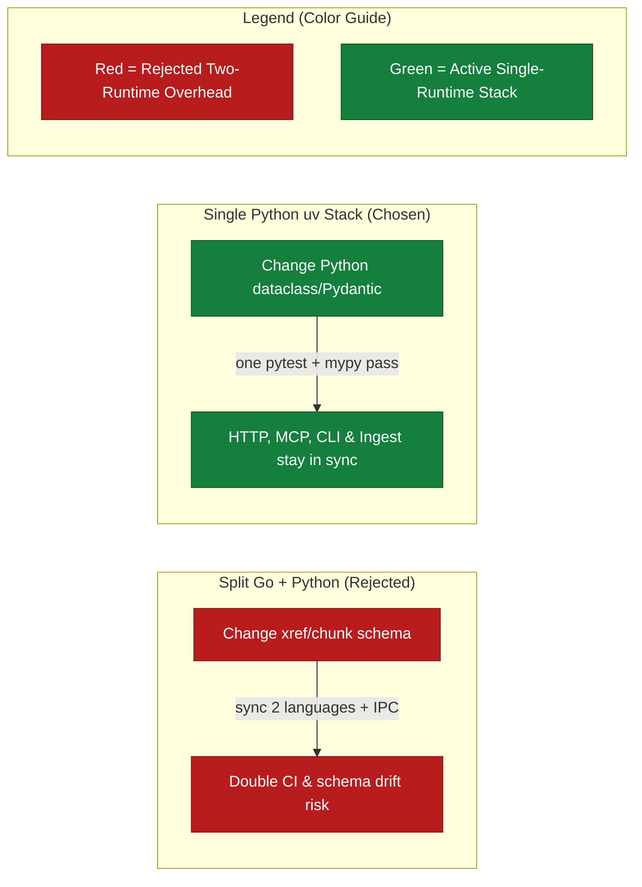

# Architectural Decisions, Pivots & Landmines (`DECISIONS_AND_TRAPS.md`)
> **1-Line Summary:** Records locked architectural choices for `RAG Manager` (`rag-manager`), including why Python `uv` beat a split Go+Python stack and critical rules for SQLite WAL, UTF-8 no-BOM, and canonical file ownership.

## 1. Architectural Decisions & Pivot History

### [DECISION: Python-UV-Over-Dual-Go-Python] | Aliases: Lima 2, Lima 3, Go vs Python, single runtime, uv
> **1-Line Summary:** Chose a single Python 3.12+ (`uv`) stack over a split Go + Python architecture so multimodal PDF/image, Groq Whisper, MCP, and SQLite ingestion share one schema and one CI loop.
* **Decision Maker:** `[DECIDED BY: AGENT - Approved by Human (Lima 1)]`
* **Original User Intention:** Avoid multi-language interference while keeping the codebase fast and reliable for AI coding agents to maintain.
* **Options Considered:**
  * **Option A (Rejected — Dual Go + Python):** Run Go `:27130` HTTP/SQLite server calling Python subprocesses for PDF page rendering, Whisper audio chunking, and embeddings. Rejected because every metadata, chunk, or `xref_id` change forces synchronized edits across two type systems, two test suites, and an IPC protocol — increasing AI maintenance drift when actual query latency (`<10 ms` SQLite FTS5) is dwarfed by Ollama/Groq network I/O anyway.
  * **Option B (Chosen — Python `uv` Single Runtime):** FastAPI + SQLite WAL FTS5 + `pypdfium2`/Pillow + Groq SDK + `mcp` + Typer `--json` CLI in one `uv`-managed repo, matching `DeepTutor`, `Nihon Subtitles Manager`, and `cli-hub`.
* **Plain-English Summary of Pivot:** One Python `uv` codebase lets AI agents edit, type-check, and test ingestion, embeddings, HTTP/MCP, and CLI commands together in one place with zero cross-language schema mismatch.
* **Visual Pivot Map (What Failed vs. What Works):**

* **Code Anchors (Grep Targets):**
  * `AGENTS.md` -> `Runtime / Language`
  * `.github/workflows/ci.yml` -> `Set up uv and Python`

### [DECISION: Standalone-RAG-Manager-Over-DeepTutor-Subpackage] | Aliases: rag-hub rename, RAG Manager, India 2, standalone repo
> **1-Line Summary:** Built `RAG Manager` (`rag-manager` on `:27130`) as a dedicated standalone repo instead of embedding it inside `DeepTutor` or dropping shared RAG altogether.
* **Decision Maker:** `[DECIDED BY: HUMAN]`
* **Original User Intention:** Prevent duplicate knowledge copies and stale sync between Obsidian, GaussBoard, Mermaid Manager, DeepTutor, and Anki, while keeping agent context focused in separate repos.
* **Options Considered:**
  * **Option A (Rejected):** Reuse DeepTutor's internal `LlamaIndex`/`LightRAG` KBs as the only index (creates copy/sync drift from GaussBoard/Mermaid/Anki and ties search availability to DeepTutor's 1.2M-LOC repo).
  * **Option B (Chosen):** Standalone `RAG Manager` repo (`C:\Users\kazir\Documents\Agentic Harness\RAG Manager`) acting as the single zero-duplication index at the center of the 5-app Pentagram.
* **Code Anchors (Grep Targets):**
  * `Index & Flowcharts/ECOSYSTEM_INTEGRATION_CONTRACT.md` -> `The Pentagram + Central RAG Manager Topology`

### [DECISION: Canonical-Owner-Plus-Xref-Live-Reindex] | Aliases: Mike 2, xref_id, conflict prevention, sync rule
> **1-Line Summary:** Enforced one canonical owner per artifact linked via `xref_id` and URIs, triggering live `RAG Manager` re-indexing instead of silent two-way file overwrites.
* **Decision Maker:** `[DECIDED BY: HUMAN (Mike 2)]`
* **Original User Intention:** Updating an item in one Pentagram app must keep the others current without two apps overwriting user edits blindly.
* **Options Considered:**
  * **Option A (Rejected):** Unconstrained automatic two-way file overwrites across apps.
  * **Option B (Chosen):** Canonical owner writes its own artifact -> notifies `RAG Manager` (`POST /v1/ingest/event` or watcher) -> cross-references and search indexes refresh immediately, while cross-app edits target only owned fields/markers (`frontmatterPatch`, `<!-- xref:block -->`, `anki_note_id`) or prompt before replacing human content.

### [DECISION: Shared-Local-Secrets-And-Bearer-Auth] | Aliases: November 2, ecosystem-secrets.json, bearer token, X-Local-Token
> **1-Line Summary:** Standardized loopback auth on `%USERPROFILE%\.local\share\ecosystem-secrets.json` (`LOCAL_ECOSYSTEM_SECRETS`) with `Authorization: Bearer <token>` and optional `X-Local-Token` fallback.
* **Decision Maker:** `[DECIDED BY: HUMAN (November 2)]`
* **Original User Intention:** Eliminate manual token copy-pasting between Pentagram apps without weakening localhost security.

---

## 2. Do-Not-Touch Engineering Landmines (Traps)

### [TRAP: Loopback-Binding-And-Origin-Guard] | Aliases: 0.0.0.0, CORS, DNS rebinding, origin header
> **1-Line Summary:** Never bind `RAG Manager` to `0.0.0.0` or allow browser `Origin` headers — any web page you visit could otherwise read your private vault and books index.
* **Strict Rule:** **NEVER** bind Uvicorn outside `127.0.0.1`, skip `Host` header validation, or omit `Origin` header rejection (`403`) + Bearer verification.
* **Why This Trap Exists (Plain English):** Localhost services without `Origin` + `Host` + Bearer checks are vulnerable to cross-site requests and DNS rebinding from malicious browser tabs.
* **Planned Protected Anchors:**
  * `src/rag_manager/server.py` -> `verify_loopback_request`

### [TRAP: SQLite-WAL-Single-Writer-Only] | Aliases: database is locked, sqlite wal, busy_timeout, single writer
> **1-Line Summary:** Only the `RAG Manager` service may write to its SQLite database; CLI reads or external tools must either call `:27130` or open with `?mode=ro`, and WAL + `busy_timeout=5000` must always be enabled.
* **Strict Rule:** **NEVER** write to the index `.sqlite3` file from background scripts or sibling apps directly while `RAG Manager` runs.
* **Why This Trap Exists (Plain English):** Multiple concurrent SQLite writers on Windows trigger `SQLITE_BUSY` corruption or lock errors across watchers, CLI commands, and FastAPI workers.
* **Planned Protected Anchors:**
  * `src/rag_manager/db.py` -> `IndexStore.connect`

### [TRAP: Canonical-Owner-No-Silent-Clobber] | Aliases: overwrite, file conflict, obsidian note, gaussboard sidecar
> **1-Line Summary:** Never let `RAG Manager` or a sync script overwrite a canonical user-owned Markdown note, `.gaussboard` board, or `.drawio` diagram directly without targeting explicit owned markers or user confirmation.
* **Strict Rule:** **NEVER** overwrite full user files from ingestion/sync hooks; only update `RAG Manager`'s own SQLite index or explicitly app-owned markers (`frontmatterPatch` / `<!-- xref:block -->`).
* **Why This Trap Exists (Plain English):** Automatic two-way file rewriting between Obsidian, GaussBoard, and DeepTutor causes silent data loss if you edited the file in another window.
* **Planned Protected Anchors:**
  * `src/rag_manager/xref.py` -> `sync_xref_edges`

### [TRAP: UTF8-No-BOM-And-Secret-Hygiene] | Aliases: utf8 bom, groq api key, ecosystem-secrets, electron-store
> **1-Line Summary:** Never write JSON/config/Mermaid files with a UTF-8 BOM and never log or commit `ecosystem-secrets.json` or `GROQ_API_KEY`.
* **Strict Rule:** **NEVER** write JSON with PowerShell 5.1 `Set-Content -Encoding UTF8` (always use `UTF8Encoding($false)`), and keep `ecosystem-secrets.json` strictly outside git repositories.
* **Why This Trap Exists (Plain English):** Downstream Electron JSON parsers (such as `Mermaid Manager` `electron-store`) and strict JSON loaders reject UTF-8 BOM bytes (`0xEF 0xBB 0xBF`).
* **Planned Protected Anchors:**
  * `src/rag_manager/config.py` -> `load_ecosystem_secrets`

### [TRAP: Ollama-Memory-And-Model-Thrashing] | Aliases: embeddinggemma-2, OLLAMA_NUM_THREAD, MAX_LOADED_MODELS, OOM
> **1-Line Summary:** Bound concurrent Ollama embedding requests and honor `OLLAMA_NUM_THREAD=4` / `MAX_LOADED_MODELS=1` so bulk indexing `E:\Books` does not freeze Windows or evict active chat models unpredictably.
* **Strict Rule:** **NEVER** fire unbounded parallel `asyncio.gather` embedding batches at `127.0.0.1:11434`. Use a bounded semaphore and sequential/small-batch embedding queues.
* **Why This Trap Exists (Plain English):** Rendering and embedding hundreds of textbook pages through multimodal `embeddinggemma-2:440m` without concurrency limits saturates CPU/VRAM and stalls interactive DeepTutor/Obsidian responses.
* **Planned Protected Anchors:**
  * `src/rag_manager/embedder.py` -> `OllamaMultimodalClient`
